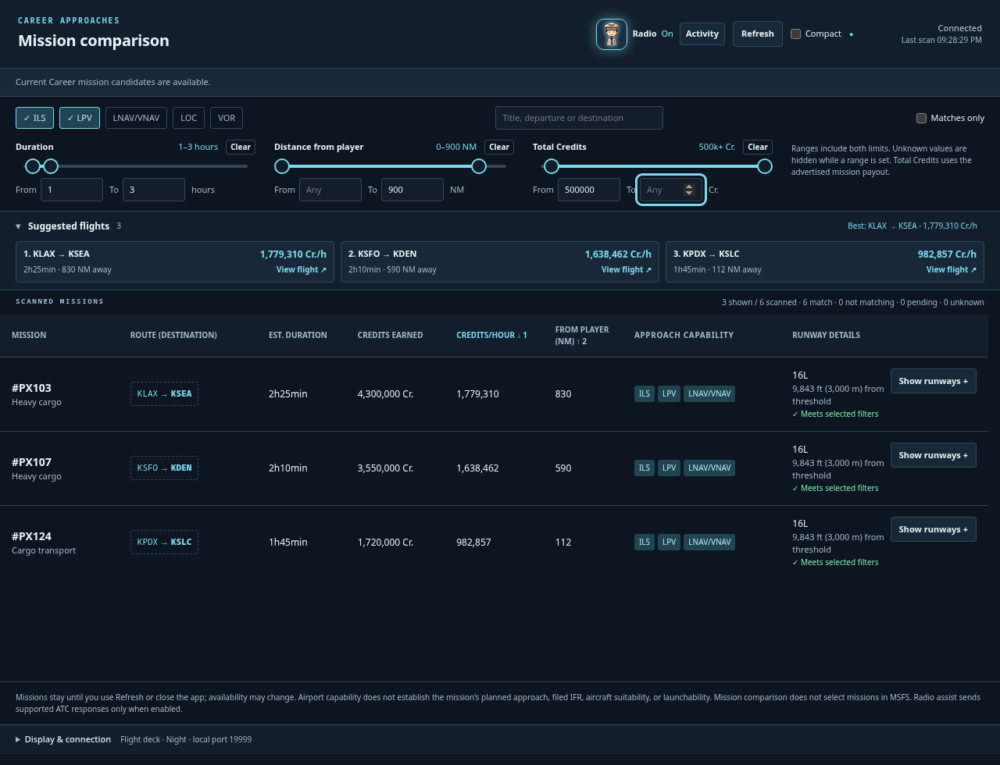
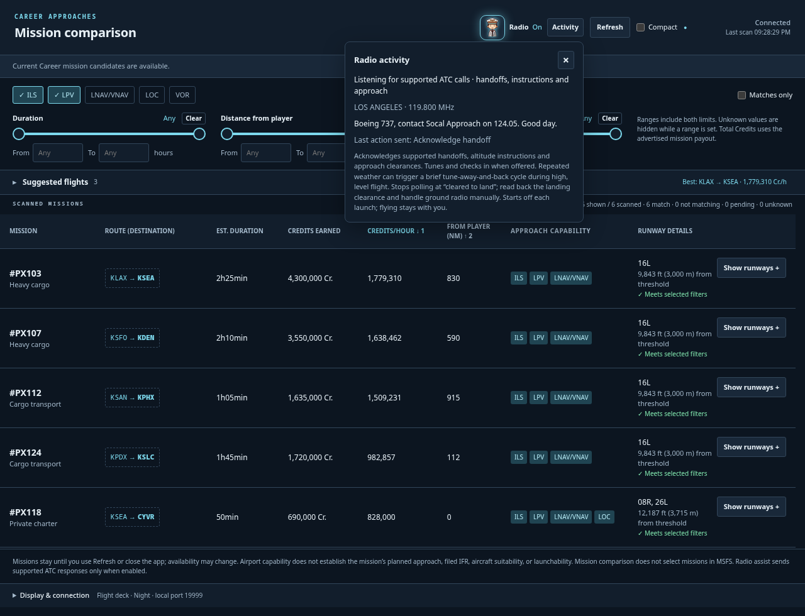
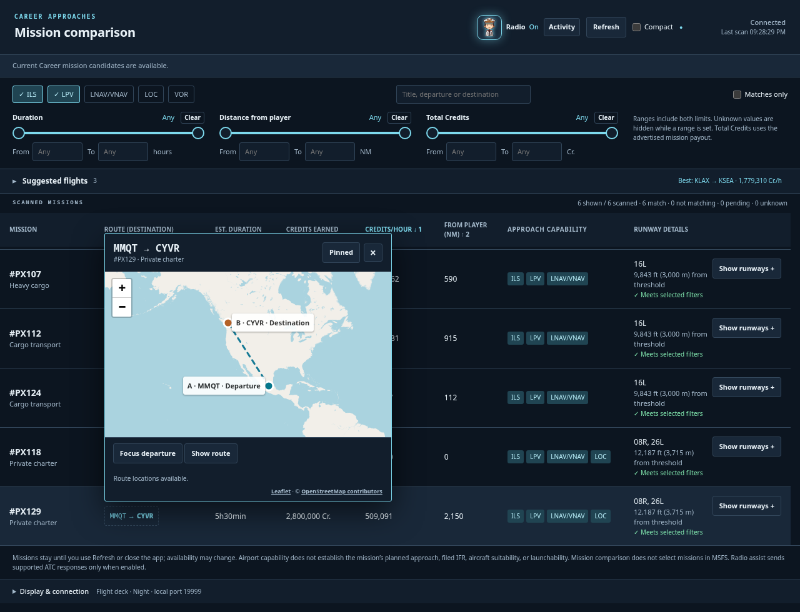
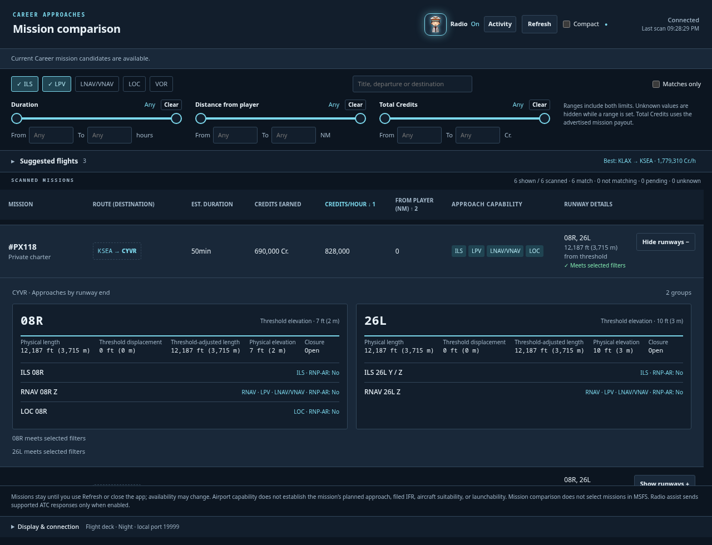
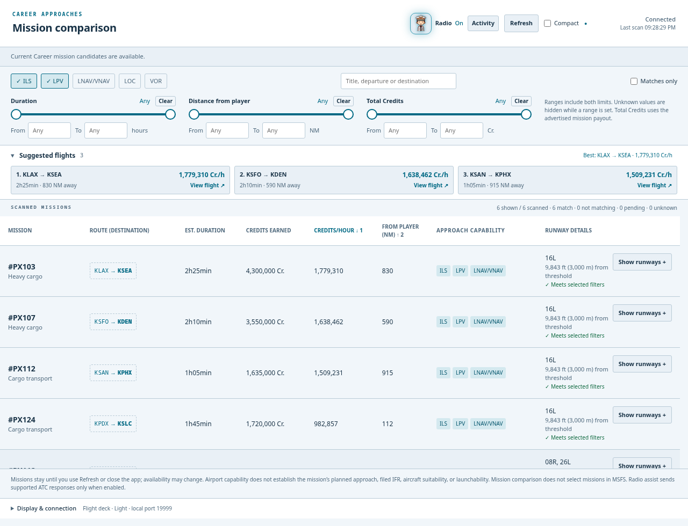
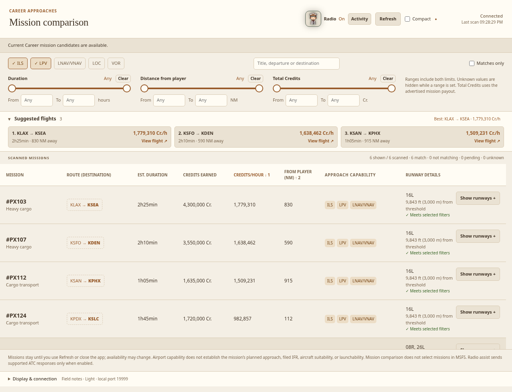
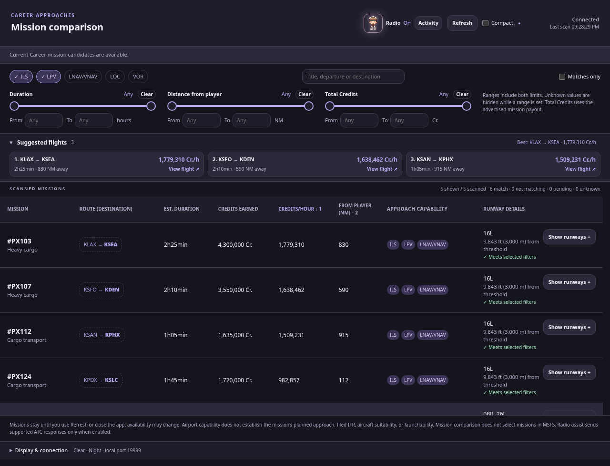

# MSFS 2024 Career Approach Companion

Compare MSFS 2024 Career missions by payout, credits/hour, duration, departure distance and destination approaches. Available for Linux and Windows x64.

Filter for ILS, RNAV (LPV and LNAV/VNAV), LOC or VOR, inspect runway details, and preview airports on a map. Airport capability does not guarantee the mission’s assigned approach or aircraft suitability. Mission selection stays in MSFS.

## Get started

Download your platform’s package and `SHA256SUMS` from [Releases](https://github.com/JarlaxleXenocide/msfs2024-mission-companion/releases). Node is bundled; GitHub’s source archives are not executable builds.

- **Linux:** verify with `sha256sum --check --ignore-missing SHA256SUMS`, extract the ZIP, and run `./career-companion`. Keep the runtime files together; do not run with sudo or disable the sandbox.
- **Windows:** compare the download’s `Get-FileHash -Algorithm SHA256` result with `SHA256SUMS`, then run the setup EXE. For portable use, extract the entire ZIP and launch `career-companion.exe`. Packages are unsigned.

Start MSFS, enter Career outside briefing, and press **G** with the simulator focused to expand its Missions panel. Keep it open while scanning.

The local Coherent inspector must expose `mainUi` and `Electronic Flight Bag` at `http://127.0.0.1:19999/pagelist.json`. Setup varies; the companion does not enable it automatically. Change the port or retry through **Display & connection**.

## Using the companion

- Pan the Career map to collect missions. **Refresh** clears collected missions and cached airport data, then rescans the current area.
- Combine search, approach and range filters. Drag a range or type its bounds; leave a side blank for no limit. Unknown values are excluded when a range is set.
- Click column headings to cycle descending → ascending → off. Numbered arrows show sort priority. Credits/hour uses advertised payout and duration; distance runs from the Career pilot’s airport to the departure airport.
- **Suggested flights** ranks up to three matches by credits/hour, then nearer departure. Collapse it for more space; **View flight** opens runway details.
- Hover a route to preview its airports; click to pin it. Escape closes it. The line connects endpoints, not the flight plan. OpenStreetMap imagery requires internet and reveals the viewed region to the tile provider.
- Choose a theme, Compact mode and supported keep-on-top behavior. Settings persist; collected missions and airport data do not survive closing the app.

## Radio assist (experimental)

Use the header’s pilot button to enable it; **Activity** shows the frequency, latest message and last action. It starts **off** each launch and uses the simulator’s ATC menu, without a microphone or cloud service.

Supported English calls include handoffs, climb/descend-and-maintain instructions, “Keep speed not above … knots” instructions, descend-via clearances and approach acknowledgments. It can send responses and change COM frequencies, but does not fly the aircraft, validate clearances or decide when you are inbound.

**It switches off at “cleared to land.” Read back that clearance and handle ground/taxi calls yourself.** Departure procedures, alternate approaches and unrecognized calls also remain manual.

Repeated weather broadcasts can trigger a tune-away-and-back attempt using the transmitting radio’s existing standby frequency. Recovery is limited to high, level flight (at least 18,000 ft, within ±300 ft/min), with no active approach or observed arrival/descent cues. **This recovery is covered by automated tests but has not been verified in flight.** Check the active frequency if it fails.

Developed around the default Asobo 737 MAX 8; other aircraft, wording and simulator updates may behave differently. Disconnections or uncertain actions turn assistance off. Follow the displayed recovery instructions; an uncertain operation requires a simulator/view restart. The experimental Coherent integration cannot guarantee simulator stability. Stay ready to take over manually.

## Screenshots

v0.1.8 with illustrative missions and airport data, not live availability or payouts.

Sort by earnings and departure distance.


Combine duration, distance and payout filters.



Compact, collapsible flight suggestions.


Radio controls and floating activity panel.



Preview and pin mission routes.



Inspect runway lengths, elevations and approaches.



Flight deck, Field notes and Clear themes support Light, Night and system appearance.

| Flight deck · Light | Field notes · Light | Clear · Night |
| --- | --- | --- |
|  |  |  |

## Troubleshooting

- **No missions:** check that Career is outside briefing and the native Missions panel is expanded. Check inspector discovery with `curl --max-time 3 http://127.0.0.1:19999/pagelist.json` or PowerShell’s `Invoke-RestMethod`.
- **Stale data or stalled queries:** follow the status message and let pending requests settle. Reconnecting does not cancel simulator-side work.
- **In-flight scanning:** mission collection pauses outside the Career browser, with a return check every ten seconds. Radio polls separately while enabled; its landing-clearance stop does not stop the browser-return check.
- **Linux libraries:** Electron requires NSS, GTK, GBM and ALSA. Debian 12/Ubuntu 22.04 use `libnss3 libgtk-3-0 libgbm1 libasound2`; Ubuntu 24.04 uses `libgtk-3-0t64 libasound2t64` for GTK/ALSA.
- **Window behavior:** Linux defaults to X11/XWayland when available. Native Wayland has limited minimize reporting and desktop-managed pinning. Keep-on-top over exclusive fullscreen depends on the desktop.
- **Old app after building:** replace the installed package and update its desktop shortcut, then restart it. A local build does not update an existing installation.

## Development

Requires Node ≥22.12.0 and npm. Linux builds also need `zip`, `unzip` and the system libraries above.

```sh
npm ci
npm run audit
npm test
npm run typecheck
npx playwright install chromium
npm run make -- --platform=linux --arch=x64
CI=true npm run test:renderer
npm run verify:artifact
```

For Windows, build on x64 Windows with `--platform=win32`, set `$env:CI = 'true'` before renderer tests, and verify with `node scripts/verify-artifact.cjs --platform=win32 --arch=x64`.

Renderer tests use synthetic data without connecting to MSFS. Run them before `npm start`, which replaces packaged intermediate assets with development assets. Build output is under `out/`; verified Windows packages are under `out/verified/windows-x64/`.

CI checks tests, dependencies, UI behavior, package contents, Windows installation and Linux runtime libraries. Audit exceptions are listed in `scripts/audit-dependencies.cjs`. Release tags must match `package.json` with a `v` prefix; releases default to drafts unless `RELEASE_PUBLICATION_ENABLED=true`. Existing releases are never overwritten. Source is `UNLICENSED`.

## Credits

- [Leaflet](https://leafletjs.com/) — license included in [THIRD-PARTY-LICENSES.md](THIRD-PARTY-LICENSES.md).
- Map data © [OpenStreetMap contributors](https://www.openstreetmap.org/copyright); [tile usage policy](https://operations.osmfoundation.org/policies/tiles/).
- [Pilot icon](https://cdn-icons-png.magnific.com/256/13627/13627610.png?semt=ais_white_label), bundled locally.
- 🇺🇦 [Support Ukraine](https://stand-with-ukraine.pp.ua/), linked by the Leaflet team.
